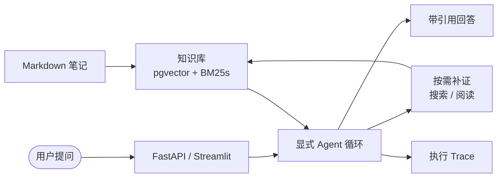

<h1 align="center">NoteAgent</h1>

<p align="center">
  <a href="https://docs.python.org/3.11/"></a>
  <a href="https://fastapi.tiangolo.com/"></a>
  <a href="https://docs.streamlit.io/"></a>
  <a href="https://github.com/pgvector/pgvector"></a>
  <a href="https://docs.docker.com/compose/"></a>
  <a href="LICENSE"></a>
</p>

面向个人 Markdown 和文本笔记的知识库 Agent。导入笔记后，用自然语言提问、继续追问，并通过来源引用和执行记录核对回答依据。

## 功能

- **笔记问答**：检索相关内容，整理要点或比较不同笔记中的信息。
- **按需检索与阅读**：根据已有证据决定是否继续搜索或读取文档正文。
- **多轮对话**：结合当前会话的近期问答理解追问，支持新建和切换会话。
- **来源与执行记录**：提供回答引用，支持查看检索、工具调用、结果和耗时。
- **增量维护**：通过命令导入、查看和删除文档，跳过内容及索引配置未变化的文档。

## 快速开始

下载本仓库，或使用 Git 克隆并进入项目目录：

```bash
git clone https://github.com/xrmpp/NoteAgent.git
cd NoteAgent
```

### 环境要求

- Docker 与 Docker Compose；Windows、macOS 可使用 Docker Desktop。
- 兼容 OpenAI Chat Completions 接口、支持工具调用和 JSON 输出的生成模型服务。
- 兼容 `/v1/embeddings` 接口的向量模型服务。下面以 Docker Desktop 连接本机 Ollama 为例。

以下命令均在项目根目录执行。应用所需的 Python 和依赖由容器提供。

### 1. 创建配置文件

首次使用时，将 `.env.example` 复制为 `.env`。已有 `.env` 时直接编辑该文件。

Windows PowerShell：

```powershell
Copy-Item .env.example .env
```

macOS / Linux：

```bash
cp .env.example .env
```

两条命令均用于创建本地配置文件，按所用终端选择一条执行。

### 2. 配置生成模型

编辑 `.env`，将下面的地址、密钥和模型名替换为你的服务配置：

```dotenv
MODEL_PROVIDER=openai_compatible
OPENAI_BASE_URL=https://your-provider.example/v1
OPENAI_API_KEY=your-api-key
MODEL_NAME=your-model-name
```

`OPENAI_BASE_URL` 填写服务的 API 根地址，不包含 `/chat/completions`。`openai_compatible` 表示接口格式，不限定模型厂商。

### 3. 配置向量模型

在本机安装并启动 Ollama，然后下载 [BGE-M3](https://ollama.com/library/bge-m3)：

```bash
ollama pull bge-m3
```

该命令下载用于文本向量化的模型。保持 Ollama 服务运行，在 `.env` 中替换 embedding 配置：

```dotenv
EMBEDDING_PROVIDER=openai_compatible
EMBEDDING_BASE_URL=http://host.docker.internal:11434/v1
EMBEDDING_API_KEY=local
EMBEDDING_MODEL=bge-m3
EMBEDDING_DIMENSIONS=1024
EMBEDDING_BATCH_SIZE=8
EMBEDDING_TIMEOUT_SECONDS=180
```

本例通过本机 Ollama 的 `/v1/embeddings` 接口生成向量，不使用云端 embedding。`local` 是非空占位值，本地 Ollama 不校验该密钥。参见 [Ollama 兼容接口说明](https://docs.ollama.com/api/openai-compatibility)。

`host.docker.internal` 是 Docker Desktop 访问宿主机的地址。使用其他部署环境或向量服务时，填写容器可访问的 API 地址、对应密钥、模型名和输出维度。`EMBEDDING_DIMENSIONS` 必须与模型输出一致。

生成模型和向量模型独立配置，两组配置都需要完成。`.env.example` 中的 `hash` 仅为占位向量，不具备语义检索能力，应替换为上述配置或其他真实向量服务。

### 4. 启动服务

默认会向空知识库导入示例文档。若只使用自己的笔记，启动前在 `.env` 中设置 `AUTO_INGEST_DEMO_CORPUS=false`。

```bash
docker compose up --build -d
```

该命令构建镜像并在后台启动网页、API 和数据库。启动后打开 [http://127.0.0.1:8501](http://127.0.0.1:8501)。

### 5. 开始提问

使用默认示例文档时，可以问：

> 文档重新导入时，系统如何避免产生重复的过期切片？

使用自己的笔记时，先按下一节导入，再提问。回答中可查看来源引用，点击“查看 Trace”查看本次执行记录；同一会话可继续追问，新话题可新建会话。

## 管理笔记

将 Markdown 或 txt 笔记放入 `data/personal_notes/`，支持子目录。

### 导入或更新

```bash
docker compose exec -T api python -m app.rag ingest /knowledge
```

该命令递归导入笔记：新文档新增，已修改的文档更新，内容及索引配置均未变化的文档跳过。输出包含每篇文档的处理结果和汇总；有失败项时，修复后可重新执行同一命令。

### 查看文档

```bash
docker compose exec -T api python -m app.rag list
```

该命令列出已入库文档的 `source`、标题和切块数量等信息。`source` 是删除文档时使用的标识，例如 `python/async.md`。

### 删除文档

将下面的 `python/async.md` 替换为 `list` 返回的实际 `source`：

```bash
docker compose exec api python -m app.rag delete python/async.md
```

该命令展示目标文档，输入 `DELETE` 后删除文档及其切片，不清除聊天历史或本地原始文件。原文件保留时，下次导入会重新入库；仅从本地目录删除文件，不会自动删除库中内容。

## 工作原理

每次提问先通过向量检索与 BM25 获取相关片段，再由模型判断证据是否足够。需要补充资料时，模型请求 `search_knowledge` 或 `read_document`，由 Python 校验参数并执行只读操作；获得证据后生成回答并校验引用编号。




RRF（Reciprocal Rank Fusion，倒数排名融合）用于合并向量与 BM25 的检索排名。问答通过 SSE 传递执行进度，答案在生成完成后显示，不是逐 token 输出。

更完整的模块边界、文档维护和持久化说明见 [架构说明](docs/architecture.md)。

## 使用边界

- **输入格式**：仅支持非空 UTF-8 编码的 `.md`、`.txt` 文件，单篇不超过 1 MiB。暂不解析文档中的图片，也不直接导入 PDF 或扫描件。
- **文档标识**：`source` 为相对导入目录的路径；相同路径会被视为同一文档。重命名后需导入新路径，并单独删除旧标识。
- **向量配置**：更换向量模型或维度前请备份数据。旧向量不能直接混用，维度变化还需调整数据库结构。
- **回答依据**：引用用于核对来源，不保证回答的理解和结论正确；重要信息应核查原文。
- **运行恢复**：浏览器断开后，不保证任务继续执行或自动恢复。

## 数据与安全

- 知识库、对话和执行记录保存在 PostgreSQL 的 `postgres_data` 数据卷中，原始笔记保留在本地目录。删除数据卷会丢失库中数据。
- 模型推理位置由配置的服务决定。使用外部生成或向量服务时，问题、必要的对话上下文或笔记文本会发送给对应服务。
- 默认网页仅供本机访问，API 和数据库不发布宿主端口。项目没有登录鉴权和多用户隔离，不要直接向公网或不可信网络开放。
- 不要提交包含真实密钥的 `.env`、私人笔记或含敏感内容的执行记录。

## 许可证

本项目采用 [MIT License](LICENSE)。
