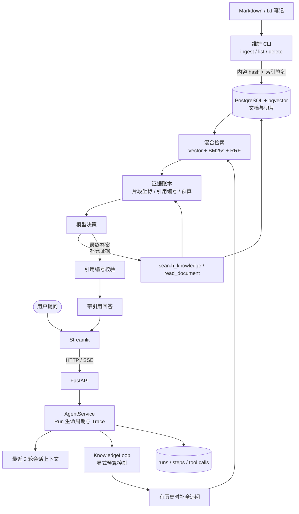

# NoteAgent 架构说明

本文面向希望阅读、扩展或审查 NoteAgent 的贡献者，描述当前公开实现的主要模块和数据流。它不记录开发进度、私人笔记、运行证据或内部计划。

## 定位与边界

NoteAgent 是一个本地个人知识库问答应用。用户导入 Markdown 或纯文本笔记后，可以用自然语言提问、继续追问，并通过引用编号和执行 Trace 核对回答依据。

当前版本是单用户应用：没有登录鉴权、多租户隔离、分布式任务恢复或并发压测结论。SSE 只传递当前 HTTP 请求内的执行进度；连接断开后不保证后台任务继续执行。

## 模块分工

| 模块 | 职责 |
| --- | --- |
| `app/ui/` | Streamlit 界面，负责会话操作、进度展示和按需查看 Trace |
| `app/api/` | FastAPI 接口，提供问答、会话、文档导入和 SSE 进度接口 |
| `app/agent/service.py` | 创建 Run、读取会话上下文、消费 Agent 事件并持久化结果 |
| `app/agent/loop.py` | 显式单 Agent 控制流、模型轮次、工具预算、超时和收尾 |
| `app/agent/evidence.py` | 证据账本：片段坐标、引用编号、已交付字符预算 |
| `app/agent/tools.py` | `search_knowledge` 与 `read_document` 的唯一校验和执行入口 |
| `app/agent/rag_answer.py` | 最终答案解析与引用编号校验 |
| `app/agent/rag.py` | Vector + BM25s + RRF 检索和原文读取 |
| `app/rag/` | 文档导入、查看、删除和维护 CLI |
| `app/storage/` | 对话、知识文档/切片、Run、步骤和工具调用的 PostgreSQL 持久化 |
| `app/llm/` | 生成模型和 embedding provider 的适配层 |

## 总体数据流

## 在线问答链路

1. Streamlit 或 HTTP 客户端提交当前问题和会话 ID。
2. `AgentService` 创建 Run，读取同一会话最近 3 轮已完成问答；有历史时先补全成独立问题。
3. 初次检索通过 pgvector 向量检索、`bm25s` 词法检索和 RRF 融合排序，向模型交付 Top-3 短预览片段。
4. `EvidenceStore` 记录片段坐标、引用编号、阅读范围和本轮最多 20,000 字符的证据预算。
5. `KnowledgeLoop` 在最多 8 次模型调用、6 次工具尝试和 120 秒总预算内运行。模型认为证据不足时，可以调用只读工具补充搜索或阅读正文。
6. 工具参数由 Python 校验；重复调用、超时和预算耗尽都有明确的结束状态。
7. 最终回答必须是结构化 JSON；`CitationValidator` 检查引用编号是否来自本轮实际交付的证据，正文引用与编号列表是否一致。引用校验只检查编号和交付证据的对应关系，不证明结论在语义上正确。
8. `AgentService` 消费步骤事件，将 Run、步骤、工具调用、耗时和终态写入 PostgreSQL；Streamlit 按需加载本次 Trace。

## 文档进入、更新与删除

文档维护统一通过 `app.rag` 命令执行：

- `ingest <目录>`：递归扫描 Markdown 和 txt，新文档新增，已修改文档更新；内容哈希与索引签名都未变化时跳过 embedding 和切片替换。
- `list`：列出已入库文档的稳定 `source`、标题和切片数量。
- `delete <source>`：展示目标并要求显式确认，删除文档及其切片；不会因为本地文件缺失自动删库。

更新已有文档时，embedding 完成后在单文档事务中替换旧切片，避免新旧内容混在同一文档里。BM25 索引根据语料指纹检测变化并按需重建。

## 存储与失败边界

- 知识内容保存在 `knowledge_documents` 和 `knowledge_chunks`，向量由 pgvector 保存。
- 会话、消息、Run、步骤和工具调用分别持久化，Trace 表示可观察的执行记录，不是完整私有思维链。
- 浏览器断开、模型服务失败、工具参数错误和预算耗尽会留下明确的终态或错误记录，但不保证自动恢复。
- 没有身份验证和多租户隔离的应用不应直接暴露到不可信网络。
